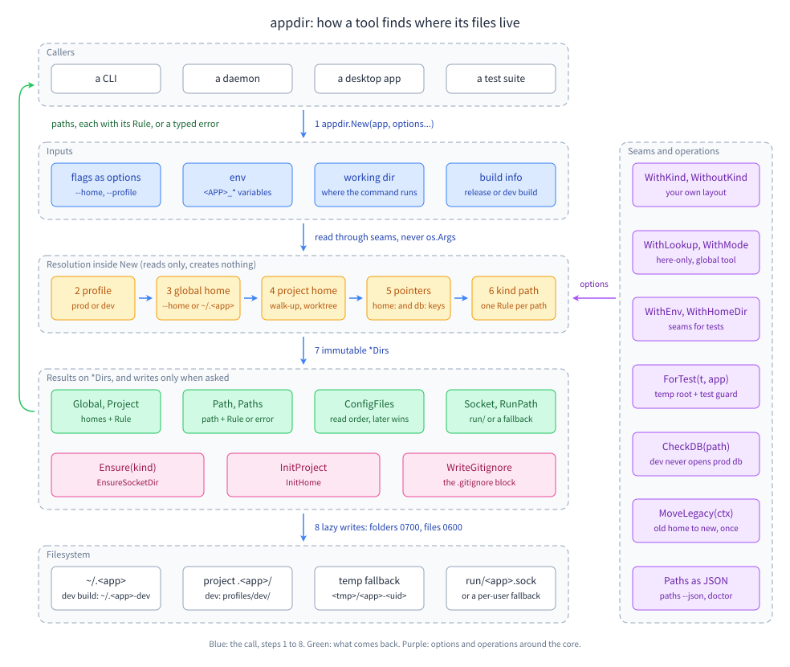

# appdir

Where a Go tool keeps its things: the global home (`~/.<app>`), the project home (`.<app>/`, found by walking up), the files and folders inside them, the prod/dev profile split, pointer keys, and moving an old home. Every path comes with the rule that picked it, so `paths --json` and `doctor` can say why.

Standard library only; macOS, Linux, Windows. A `*Dirs` is immutable and safe for concurrent use: resolve once, share it everywhere.

> Status: v0.1.x, before 1.0: the API may still change between minor versions.



## Install

```sh
go get github.com/ubgo/appdir
```

## Quick start

Resolve once with `New`; it reads and creates nothing. This function is from [examples/quickstart](examples/quickstart), which passes seams so it runs in a temp folder; a real tool passes its own flags instead (`appdir.WithHome(flagHome)`, `appdir.WithProfile(flagProfile)`) and leaves the user's home, working folder and environment to appdir.

<!-- snippet: examples/quickstart/main.go#open -->
```go
// open resolves every home for the app. The three seams keep the example
// away from the real machine: the user's home, the working folder and the
// environment all come from the caller. WithRelease(true) keeps the prod
// profile, so folders have their plain names (.lore, not .lore-dev).
func open(home, workDir string) (*appdir.Dirs, error) {
	d, err := appdir.New(appName,
		appdir.WithHomeDir(func() (string, error) { return home, nil }),
		appdir.WithWorkDir(workDir),
		appdir.WithEnv(func(string) (string, bool) { return "", false }),
		appdir.WithRelease(true),
	)
	if err != nil {
		return nil, fmt.Errorf("appdir: %w", err)
	}
	return d, nil
}
```

Then create folders only when you write to them:

<!-- snippet: examples/quickstart/main.go#ensure -->
```go
// ensure creates folders on first use. For a folder kind it creates the
// folder; for a file kind (the db) it creates the parent folder only and
// returns the file path for the caller to open.
func ensure(w io.Writer, root string, d *appdir.Dirs) error {
	for _, k := range []appdir.Kind{appdir.KindCache, appdir.KindLogs, appdir.KindDB} {
		p, err := d.Ensure(k)
		if err != nil {
			return fmt.Errorf("ensure %s: %w", k, err)
		}
		fmt.Fprintf(w, "Ensure(%s): %s\n", k, show(root, p))
	}
	fmt.Fprintf(w, "global home exists: %v\n", exists(d.Global().Base))
	return nil
}
```

`show` and `exists` are two small helpers in the same file (a path relative to the temp root, and a stat). Run it with `go run ./examples/quickstart`. Before opening a database, call `d.CheckDB(path)`: a dev build refuses the prod database ([Prod-db guard](docs/profiles/prod-db-guard.md)).

## What it decides

| Question | Default | Change it with |
|---|---|---|
| Global home | `~/.<app>` (`~/.<app>-dev` for dev) | `--home`, `<APP>_HOME` |
| Project home | nearest `.<app>/` walking up, stopping at a repo root, `$HOME`, a disk change or `<APP>_CEILING_DIRS`; a linked worktree uses the main checkout | `WithLookup(appdir.HereOnly)`, `home:` / `db:` pointer keys |
| Layout | `home.jsonc`, `config.jsonc`, `config.local.jsonc`, `shared/`, `<app>.db`, `backups/`, `cache/`, `run/`, `logs/` | `WithKind`, `WithoutKind`, `<APP>_<KIND>_DIR` |
| Data scope | project home (`ModeProject`) | `WithMode(appdir.ModeGlobal)`, `Scoped` per kind |
| What goes to git | `home.jsonc`, `config.jsonc`, `.gitignore`, `shared/**` | `WithGitCommit`, `WithGitIgnore` |
| Profile | release build → `prod`, anything else → `dev` | `--profile`, `<APP>_PROFILE`, `WithRelease`, `WithProfiles` |
| Socket | `run/<app>.sock`, a per-user fallback folder when too long, a named pipe on Windows | `WithSocketMaxLen`, `WithRunFile` |

Every default is an option: see the [options reference](docs/reference/options.md).

## Documentation

- [Learning path](docs/README.md): fourteen steps from the first call to a production setup, each with a guide and a runnable example.
- [Choosing](docs/choosing/README.md): decision guides for the mode and scopes, finding and moving homes, profiles, and the options per app type.
- [Feature index](docs/reference/features.md): every feature with its guide and example.
- [Examples](examples): sixteen runnable programs, each tested by `go test ./examples/...`.
- [SPEC](docs/SPEC.md): the design contract.

## License

Apache License 2.0. See [LICENSE](LICENSE).
