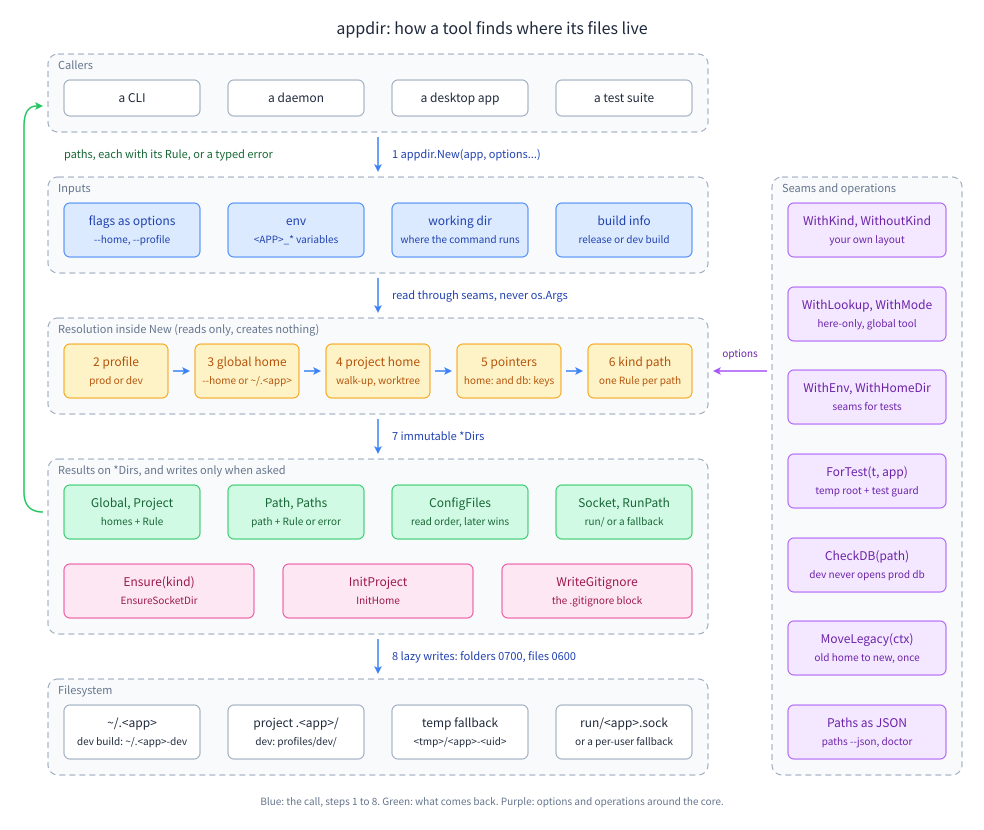

# appdir documentation

The diagram shows how `New` reads your flags, the `<APP>_*` variables, the working folder and the build info, picks a profile, resolves the global home, the project home and its pointers, and gives every kind one path with the rule that picked it; the methods on the immutable `*Dirs` then read those paths, and only `Ensure`, `InitProject`, `InitHome`, `WriteGitignore`, `EnsureSocketDir` and `MoveLegacy` write.

appdir uses the Go standard library only and runs on macOS, Linux and Windows. A `*Dirs` is immutable and safe for concurrent use: resolve once at start-up and share it. The design contract is [SPEC.md](SPEC.md); the guides below show how to use it, each with complete snippets taken from a tested example, the real output, and the pitfalls.

## Learning path

Read in this order to go from a first call to a tool that is ready for production. Each step names what you learn, the guide, and the example you can run with `go run ./examples/<name>`.

| Step | What you learn | Guide | Example |
|---|---|---|---|
| 1 | Resolve every path with `New`, read with `Path`, `PathIn` and `Paths`, create on first use with `Ensure` | [First use](start/first-use.md) | [quickstart](../examples/quickstart) |
| 2 | Create a project home with `InitProject`, and homes anywhere with `InitHome`; what a relative folder and a broken `home.jsonc` do | [Init](start/init.md), [relative folder and broken home.jsonc](start/init.md#step-6--handle-a-relative-folder-and-a-broken-homejsonc) | [project-init](../examples/project-init) |
| 3 | The global home and the project home, and how the project home is found by walking up | [Global and project homes](homes/global-and-project.md), [Lookup](homes/lookup.md) | [lookup](../examples/lookup) |
| 4 | Linked git worktrees share the main checkout's home; submodules do not | [Worktrees](homes/worktrees.md) | [worktree](../examples/worktree) |
| 5 | Let users move homes with `--home`, `<APP>_HOME` and `<APP>_<KIND>_DIR`, report a broken override; what happens with no home folder | [Overrides](homes/overrides.md), [broken override](homes/overrides.md#step-6--report-a-broken-override), [Fallbacks](homes/fallbacks.md) | [overrides](../examples/overrides), [fallbacks](../examples/fallbacks) |
| 6 | Let a team move the project home or the database with `home:` and `db:` pointer keys | [Pointer keys](pointers/pointer-keys.md) | [pointers](../examples/pointers) |
| 7 | Shape the layout: kinds, the mode, scopes, `Ignore()`, unknown kinds, dropping the home file | [Kinds](layout/kinds.md), [drop the home file](layout/kinds.md#step-6--drop-the-home-file) | [custom-layout](../examples/custom-layout) |
| 8 | What goes to git, how folders and files are created, `WithPerm`, and checking a user-given file with `VerifyFile` | [The .gitignore block](layout/gitignore.md), [Files and permissions](layout/files-and-permissions.md), [VerifyFile](layout/files-and-permissions.md#step-6--check-a-file-that-is-not-a-kind-with-verifyfile) | [custom-layout](../examples/custom-layout) |
| 9 | Which config files to read, in which order | [Config files](layout/config-files.md) | [config-files](../examples/config-files) |
| 10 | Keep dev builds away from prod: profiles, release detection, names and the banner | [Profiles](profiles/profiles.md), [Release detection](profiles/release-detection.md), [Names and banner](profiles/names.md) | [profiles](../examples/profiles) |
| 11 | Refuse the prod database in a dev build (relative paths and a prod home that does not exist yet included), and pass the profile to child processes | [Prod-db guard](profiles/prod-db-guard.md), [Child processes](profiles/child-processes.md) | [prod-db-guard](../examples/prod-db-guard), [profiles](../examples/profiles) |
| 12 | Daemon run files and sockets, and moving an old home on first run | [Run files and sockets](runtime/run-files-and-sockets.md), [Legacy move](runtime/legacy-move.md) | [daemon-paths](../examples/daemon-paths), [legacy-move](../examples/legacy-move) |
| 13 | Keep tests out of your real homes with seams and `ForTest` | [Testing setup](testing/for-test.md) | [testing-setup](../examples/testing-setup) |
| 14 | Ship `paths --json` and `doctor`, and map errors (bad options, unknown kinds) to exit codes | [paths --json and doctor](reference/paths-json.md), [Errors](reference/errors.md), [step 4: exit codes](reference/paths-json.md#step-4--map-errors-to-exit-codes) | [doctor](../examples/doctor) |

## Start from your goal

| I want to... | Guide | Example |
|---|---|---|
| decide which options my kind of tool needs | [Choosing by app type](choosing/by-app-type.md) | [quickstart](../examples/quickstart) |
| keep data per user instead of per repo | [Choosing the mode](choosing/mode-and-scopes.md) | [custom-layout](../examples/custom-layout) |
| add my own folder or file to the home | [Kinds](layout/kinds.md#step-1--declare-the-layout) | [custom-layout](../examples/custom-layout) |
| write an `init` command | [Init](start/init.md) | [project-init](../examples/project-init) |
| keep project data outside the repo | [Pointer keys](pointers/pointer-keys.md), [Choosing how a home is moved](choosing/finding-the-home.md#decision-table-moving-a-home) | [pointers](../examples/pointers) |
| put the cache or the database on another disk | [Overrides: APP_KIND_DIR](homes/overrides.md#step-3--move-one-kind-with-app_kind_dir) | [overrides](../examples/overrides) |
| make my release binary use the real homes | [Release detection](profiles/release-detection.md), [Choosing profiles](choosing/profiles.md) | [profiles](../examples/profiles) |
| stop a dev build from opening prod data | [Prod-db guard](profiles/prod-db-guard.md) | [prod-db-guard](../examples/prod-db-guard) |
| run a daemon and let clients find it | [Run files and sockets](runtime/run-files-and-sockets.md) | [daemon-paths](../examples/daemon-paths) |
| rename my tool without losing users' data | [Legacy move](runtime/legacy-move.md) | [legacy-move](../examples/legacy-move) |
| test my tool without touching my home | [Testing setup](testing/for-test.md) | [testing-setup](../examples/testing-setup) |
| tell a user where everything is and why | [paths --json and doctor](reference/paths-json.md) | [doctor](../examples/doctor) |
| tell a user their `--home` or `<APP>_HOME` is broken | [Overrides: report a broken override](homes/overrides.md#step-6--report-a-broken-override) | [overrides](../examples/overrides) |
| open a file a user named without following a symlink out of the home | [Files and permissions: VerifyFile](layout/files-and-permissions.md#step-6--check-a-file-that-is-not-a-kind-with-verifyfile) | [custom-layout](../examples/custom-layout) |
| show which config files apply when a pointer is broken | [Pointer keys: ConfigFiles under a broken pointer](pointers/pointer-keys.md#step-8--configfiles-under-a-broken-pointer) | [pointers](../examples/pointers) |
| turn a bad option set into a usage error | [Errors: ErrInvalidOption](reference/errors.md#errinvalidoption) | [doctor](../examples/doctor) |
| run in a container with no home folder | [Fallbacks](homes/fallbacks.md) | [fallbacks](../examples/fallbacks) |

## All pages

### Start

- [First use: resolve, read, ensure](start/first-use.md): `New`, `Path`, `PathIn`, `Paths`, `Ensure`, the app name rule.
- [Create a home with init](start/init.md): `InitProject`, `InitHome`, `home.jsonc`, refusing the global home, a relative folder, a broken `home.jsonc`.

### Homes

- [Global and project homes](homes/global-and-project.md): the two homes, `Global`, `Project`, `HasProject`, which home a kind uses, `WithDirName`.
- [How the project home is found](homes/lookup.md): the walk-up and its stop rules, ceiling dirs, `HereOnly`, `ErrNoProject`.
- [Worktrees and submodules](homes/worktrees.md): linked worktrees use the main checkout; submodules and bare repos do not.
- [Overrides](homes/overrides.md): `--home`, `<APP>_HOME`, `<APP>_<KIND>_DIR`, how `~` and `${VAR}` expand, the variable names, a broken override.
- [Fallbacks](homes/fallbacks.md): no home folder, the temp fallback, a read-only home, the root guard.

### Pointers

- [Pointer keys](pointers/pointer-keys.md): `home:` and `db:`, committed or local, one hop, the dev profile, `ConfigFiles` under a broken pointer, an empty local `home:`.

### Layout

- [Kinds](layout/kinds.md): the standard layout, `WithKind`, `WithoutKind`, kind options, `Ignore()`, mode and scopes, `ErrUnknownKind`, dropping the home file.
- [The .gitignore block](layout/gitignore.md): `GitignoreBlock`, `WithGitCommit`, `WithGitIgnore`, `WriteGitignore`.
- [Files and permissions](layout/files-and-permissions.md): 0700 and 0600, Windows ACLs, `CACHEDIR.TAG`, the symlink rule, the layout version guard, `WithPerm`, `WithCacheTag(false)`, `VerifyFile`.
- [Config files](layout/config-files.md): `ConfigFiles` read order, the dev profile's own file, the JSONC reader seam, a dropped config kind.

### Profiles

- [Profiles](profiles/profiles.md): detection order, `<APP>_PROFILE` limits, custom profiles, profile folders.
- [Release detection](profiles/release-detection.md): `WithRelease`, the go-install rule, `ReleaseReason`.
- [Names and banner](profiles/names.md): `Name`, `NameWith`, `Banner`.
- [Prod-db guard](profiles/prod-db-guard.md): `CheckDB`, `<APP>_ALLOW_PROD`, a `db:` pointer, relative paths, a prod home that does not exist yet.
- [Child processes and env leaks](profiles/child-processes.md): the env-leak filter, `ChildEnv`, `CleanEnv`, `ForProfile`.

### Runtime

- [Run files and sockets](runtime/run-files-and-sockets.md): `RunPath`, `Socket`, `EnsureSocketDir`, the socket fallback, `DaemonProfile`, `DaemonDiscovery`.
- [Legacy move](runtime/legacy-move.md): `MoveLegacy`, its outcomes, the old daemon lock, moving across disks.

### Testing

- [Testing setup](testing/for-test.md): seams, `ForTest`, the test-binary guard.
- [Real-OS test workflow](testing/ci.md): running the manual workflow, `APPDIR_TEST_SECOND_DISK`.

### Choosing

- [Choosing](choosing/README.md): index of the decision guides.
- [Mode and scopes](choosing/mode-and-scopes.md): project or global mode, the scope of each kind, and dropping a kind or keeping it out of git.
- [Finding the home](choosing/finding-the-home.md): walk-up or here-only, ceiling dirs, and the five ways to move a home.
- [Profiles](choosing/profiles.md): release flag or the go-install rule, custom profiles, `ForProfile`, `DaemonProfile`, `CheckDB`.
- [By app type](choosing/by-app-type.md): the option set for a project CLI, a global tool, a daemon, a desktop app and a test suite.

### Reference

- [Feature index](reference/features.md): every feature with its guide and example.
- [Options](reference/options.md): every `Option` and `KindOption` with its default.
- [Errors and exit codes](reference/errors.md): every sentinel error, when it happens, its message, a suggested exit code.
- [paths --json and doctor](reference/paths-json.md): the result types, rules and warning codes, and how to build both reports.
- [Platforms](reference/platforms.md): what differs on macOS, Linux and Windows, file by file.
- [SPEC](SPEC.md): the design contract.

## All examples

Each example except `demo` runs inside a temp folder and never touches your real home; `demo` resolves for the folder you run it in. Run one with `go run ./examples/<name>`; `go test ./examples/...` runs them all and checks their output.

- [quickstart](../examples/quickstart): `New`, `App`, `Path`, `PathIn`, `Paths`, `Ensure`.
- [project-init](../examples/project-init): `InitProject`, `InitHome`, `ErrNotHome`, refusing the global home, a relative folder, a broken `home.jsonc`.
- [lookup](../examples/lookup): the walk-up, repo-root wall, ceiling dirs, symlinked working folder, monorepo, `HereOnly`, `ErrNoProject`.
- [worktree](../examples/worktree): linked worktrees, a main checkout with no home, submodules, a bare repo's worktree.
- [overrides](../examples/overrides): `--home`, `<APP>_HOME`, `<APP>_<KIND>_DIR`, the variable names, path expansion, a broken override.
- [fallbacks](../examples/fallbacks): no home folder, `WithTempFallback(false)`, a read-only home.
- [pointers](../examples/pointers): `home:` and `db:` pointer keys and their errors, the dev profile, `ConfigFiles` under a broken pointer, an empty local `home:`.
- [custom-layout](../examples/custom-layout): `WithKind`, `WithoutKind`, `Ignore()`, `ErrUnknownKind`, init without a home file, the modes, the gitignore block, permissions, `WithPerm`, `WithCacheTag(false)`, the symlink rule, `VerifyFile`, the layout guard.
- [config-files](../examples/config-files): `ConfigFiles` in each case, merging, `WithConfigReader`, a dropped config kind.
- [profiles](../examples/profiles): profile detection, release reasons, a custom profile, names and banner, `ChildEnv`, `CleanEnv`, `ForProfile`.
- [prod-db-guard](../examples/prod-db-guard): `CheckDB` for prod and dev databases, `<APP>_ALLOW_PROD`, a `db:` pointer, a relative path, a prod home that does not exist yet.
- [daemon-paths](../examples/daemon-paths): `RunPath`, `Socket`, `EnsureSocketDir`, the socket fallback, `DaemonDiscovery`.
- [legacy-move](../examples/legacy-move): `MoveLegacy` and every outcome, `ErrBusy`.
- [testing-setup](../examples/testing-setup): seams, `ForTest`, the guard.
- [doctor](../examples/doctor): `paths --json`, the appdir part of `doctor`, a `--home` run, invalid option sets, `ErrUnknownKind`, errors mapped to exit codes.
- [demo](../examples/demo): a small tool that prints everything appdir resolves where you run it.
